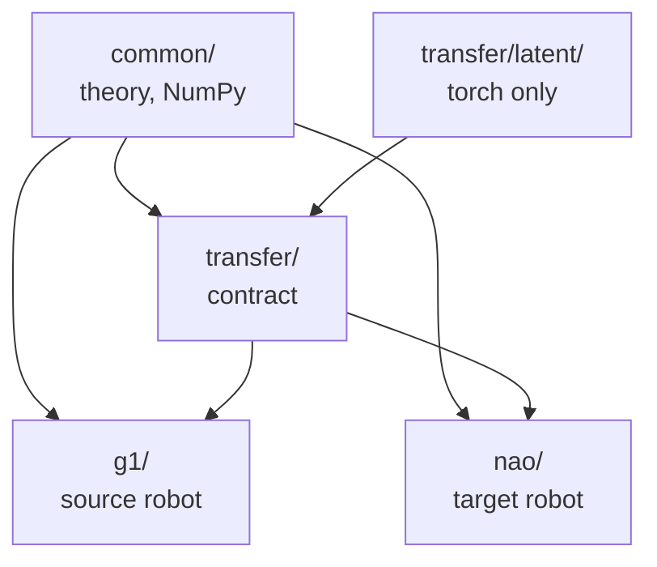

# Architecture

The project is an Isaac Lab external extension: one installable package under
`source/humanoid_transfer`, with scripts, results and documentation at the repository root.

## Package layout

The package is split by embodiment, not by software layer: a robot's model and tasks live
together, and the shared theory mentions no robot.

```text
humanoid_transfer/
├── common/      body-independent theory (NumPy): z*, units, centroidal dynamics, gait signature,
│                inverted pendulum and capture point
├── transfer/    the contract between bodies
│   ├── latent/  generator, estimator encoder, bodies' data (torch, never Isaac Lab)
│   ├── tasks/   the tracking task shared by every body: plan command, observations, reward
│   ├── retarget.py, correspondence.py   joint-angle retargeting (a baseline)
│   └── symmetry.py                      mirror symmetry of the policies
├── g1/          source robot: walking teacher, base-task experts, tracking task
├── nao/         target robot: asset pipeline, tracking task, baselines
├── soccer/      reserved for a later stage, inactive
└── tasks.py     registers every gym id
```

Each arrow points from a module to the modules that use it:



## Boundaries

Each is enforced by a test (`tests/test_import_boundaries.py`,
`tests/test_development_baseline.py`).

- **Theory does not contain robots.** `common/` takes geometry as arguments and imports no URDF.
- **Embodiments do not import each other.** `transfer/` is the only place the two robots meet.
- **Torch stops at `transfer/latent/`.** The rest of `common/` and `transfer/` is NumPy, so the
  theory is tested without a GPU stack; `latent/` uses torch but never Isaac Lab, so it trains
  and is tested on recorded rollouts.
- **Assets do not contain environments,** and tasks live with their robot.
- **The NAO's zero-step balance task (`nao/tasks/nao_stand`) is separate from the walking work.**
  It terminates on a step, which defines that task; the walking tasks carry no such condition.

## Tasks

`scripts/train.py` and `scripts/play.py` import `humanoid_transfer.tasks` before delegating to
Isaac Lab, which registers these tasks among others (each with a `-Play-v0` variant):

| Id | Robot | Purpose |
| --- | --- | --- |
| `G1Walk-Teacher-v0` | G1 | The walking teacher (Isaac Lab's flat G1 task at the Froude-matched speed) |
| `G1Base-{Backward,Sidestep,Jog}-v0` | G1 | Experts for the base tasks (Isaac Lab's recipe, command range only) |
| `G1RoughOnFlat-v0` | G1 | Isaac Lab's rough G1 policy evaluated on a plane |
| `G1Track-v0`, `NaoTrack-v0` | G1, NAO | The tracker: follow a plan of `z*` |
| `NaoVelocity{Flat,Rough}-v0` | NAO | Baseline: the NAO trained on the task with the G1's recipe |
| `NaoImitate-v0` | NAO | Baseline: imitation of the G1's retargeted joint angles |
| `NaoStand-Direct-v0` | NAO | Zero-step balance under pushes (separate study) |

`python scripts/list_tasks.py` prints the registry. Registration degrades to
`REGISTERED = False` without gymnasium or Isaac Lab, so the tests import the package anywhere.
