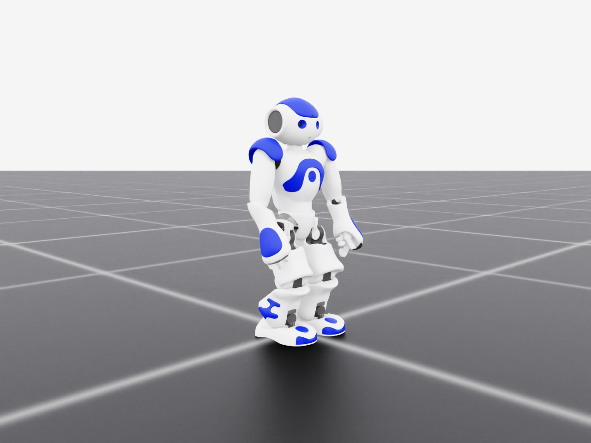
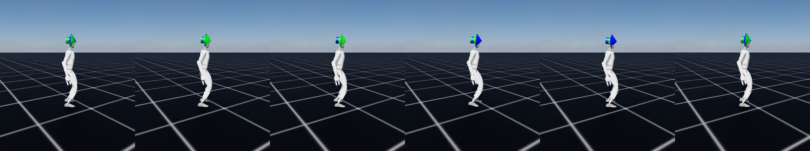

# Humanoid skill transfer

Isaac Lab research project on **cross-embodiment humanoid skill transfer**.

A skill is learned on a robot capable enough to learn it, and the research
question is what has to happen for that skill to end up on a robot that is not.

<p align="center">
  
</p>

---

## The three tracks

The repository is organised around the three parts of that question. Each is a
top-level folder with its own README, assets, documentation and scripts.

| Track | Robot | Role |
| --- | --- | --- |
| **[`nao/`](nao/)** | NAO H25 V5.0 — 5.3 kg, 0.58 m | **The target.** Limited for physical rather than algorithmic reasons, which is what makes the question a question. |
| **[`g1/`](g1/)** | Unitree G1 — 23 body DOF, ~35 kg | **The source.** Capable enough to learn the skill in the first place. Its model already exists in Isaac Lab. |
| **[`transfer/`](transfer/)** | — | **The research.** What has to change for a skill to cross the gap between them. |

```text
.
├── nao/         ← target embodiment: assets, docs, scripts, results
├── g1/          ← source embodiment: docs, scripts
├── transfer/    ← the teaching process: plan, docs
├── source/      the installable Isaac Lab extension (all Python code)
├── scripts/     cross-track entry points: train, play, list_tasks
├── tests/       run without Isaac Sim
├── ARCHITECTURE.md
└── README.md
```

The Python code lives under `source/` because Isaac Lab requires that layout for
an external extension. It is split the same three ways internally — see
[ARCHITECTURE.md](ARCHITECTURE.md).

---

## Where the work stands

### Track 1 — the target robot: **done and measured; kept, not built on**

Zero-step balance under perturbation, with a hard constraint: a foot that lifts
or slides more than 50 mm ends the episode. Without it the robot solves the task
by stepping, which is a different problem with different theory behind it.

Four controllers, one environment instance, n = 2048:

| Controller | Fall-free | 95 % CI | Ankle torque |
| --- | --- | --- | --- |
| **PPO policy** | **82.3 %** | [80.6, 84.0] | 44.0 % |
| PPO, arms frozen | 83.0 % | [81.4, 84.6] | 47.9 % |
| Joint PD | 77.6 % | [75.8, 79.4] | 34.3 % |
| Capture-point PD | 27.8 % | [25.9, 29.7] | 30.2 % |

| Contrast | Δ | z | Verdict |
| --- | --- | --- | --- |
| PPO − joint PD | +4.7 | 3.76 | **significant** |
| Arms frozen − PPO | +0.7 | 0.59 | not significant |

Established along the way, and reusable:

1. **Zero-step capturability is anisotropic by 1.87** on this robot — 0.443 m/s
   backward against 0.827 m/s toward the forward corners. Perturbation curricula
   have to be scaled by `ω₀·d(θ)`, not by an absolute speed.
2. **The inertia that sizes leg gains is the whole body about each joint axis**,
   larger by **543×** than the distal subtree at the ankle. Using the open-chain
   value is a three-order-of-magnitude error whose only symptom is falling over.
3. **PPO's entropy coefficient is not scale-free.** Adding the zero-step
   constraint cut the mean return from 116 to 25; the entropy bonus does not
   scale with the return, so buying entropy became more profitable than
   balancing. Action noise climbed 0.50 → 1.25 and performance decayed 61 % at
   *constant* difficulty, with no error anywhere.
4. **A penalty prices a behaviour; only a constraint removes it.** Soft foot
   penalties left 51 of 51 policies stepping.
5. **Sample size gates every claim.** At n = 128 the standard error near p = 0.85
   is 3.2 points, larger than any effect this task produces.

This track is **finished, and deliberately not the starting point for the NAO
walking work.** The robot's *body* — URDF, USD, kinematics, actuator model — is
shared. The balance *task* is not: its zero-step termination defines a problem
whose objective is the opposite of a gait's, and importing that criterion has
already cost two rewrites. The boundary is enforced by
`tests/test_development_baseline.py`; the reasoning is in
[ARCHITECTURE.md](ARCHITECTURE.md#boundaries).

### Track 2 — the source robot: **trained and verified walking**

`G1Walk-Teacher-v0`, built on Isaac Lab's `G1FlatEnvCfg`, with commands capped at
the Froude-matched speed (0.249 m/s, corresponding to 0.15 m/s on the NAO).

<p align="center">
  
</p>

| Quantity | Value |
| --- | --- |
| Training | 1500 iterations, 147.5 M steps, 1 h 58 m |
| Commanded / achieved forward velocity | 0.249 / **0.206** m/s (83 %) |
| Foot clearance | 51–60 mm mean, up to 79 mm |
| Rollouts captured | 400 steps × 32 envs, all three candidate signals |

Isaac Lab ships **no pretrained weights** for the G1 — it ships the model, the
environment and the PPO hyperparameters. Exactly one field was changed, the
command velocity range, and these weights were produced here.

They are **pinned in [`g1/policy/`](g1/policy/README.md)** and hashed: the one
derived binary this repository tracks, because it is the one artifact that cannot
be regenerated. A rerun under another seed is a different gait, and every
transfer comparison is a comparison against this teacher.

**→ [`g1/TRAINING.md`](g1/TRAINING.md)** documents the provenance of every
component, the one variable that was chosen and why, the learning curve, and how
the gait was verified rather than assumed.

### Track 3 — the transfer: **a G1 skill reaches the NAO zero-shot**

A skill crosses bodies as a **contract**: the short future of `z*`, 27
dimensionless numbers that say what a body is doing, not how its joints move —
CoM height and velocity, tilt, turn rate, feet, the weight on each foot, angular
momentum. Lengths are in leg lengths and times in `√(L/g)`, so dynamically
similar motions of a 1.3 m and a 0.57 m robot are the same vector.

| Trained | How often | On what |
| --- | --- | --- |
| A skill's **generator** (plans of `z*`) | once per skill | the G1's expert alone |
| A body's **encoder** (sensors → `z*`) and **tracker** (plan → joints) | once per body | a physical family of plans from a point-mass biped — never a skill |

A new skill therefore costs one training, on the G1, however many bodies run it:
**N + M trainings, not N × M.**

Both of Isaac Lab's published G1 locomotion policies have been transferred:
`Isaac-Velocity-Flat-G1-v0` and `Isaac-Velocity-Rough-G1-v0`. Neither body ever
saw their data, and both trackers are frozen.

**The model as it stands.** These are the incumbents of
[`transfer/results/incumbents.json`](transfer/results/incumbents.json), changed
only by a pre-registered rule: more than two bootstrap standard errors better, and
no worse on the regression suite S0.

| Part | What it is | Trained on |
| --- | --- | --- |
| Generator, per skill | plans of `z*` (`flat_dagger2`; `rough_b4`, which reads its noise level) | the G1's expert only |
| Estimator, per body | `z*` from the body's own kinematics; the loads from a learned encoder | — |
| Tracker, per body | a plain MLP, symmetrized at deployment (G1 `r3_6194`, NAO `r1_3498`) | a physical family of procedural plans, never a skill |

Results are on the deployed path, over three commands (forward, fast, turning;
64 episodes each). "Passes" counts the commands whose gait signature is within
tolerance of the teacher's:

| Skill | G1 | NAO |
| --- | --- | --- |
| Flat | **0 / 192** falls, passes 3 | **0 / 192** falls, passes 3 |
| Rough | **0 / 192** falls | **0 / 192** falls, passes 2 of 3 at its own rate |
| Before this method | 120–240 falls on flat | shuffling, 14–41 % of the speed |

The NAO's longer stance on rough is the one shortfall left. Its step is 1.62 × the
G1's in body time, and the G1's own plans, sampled at the NAO's rate, show the same
stance.

**What did not win: decoder v2.** It adds physics in the decoder: an IK and
feed-forward prior with an RL residual, physics heads and a physics critic. It also
tried a deep-learning core: a temporal plan encoder and a residual trunk. Each was
tested at equal competence: distilled from the incumbent, then trained alike. Against
a control distilled the same way, on the G1:

| Arm | Rough falls | Walk speed / teacher | Family duty vs control |
| --- | --- | --- | --- |
| Distilled control (the incumbent's network) | 62 / 225 | 0.96 | — |
| Physics prior | **0 / 192** | 0.81 | worse, +0.034 ± 0.006 |
| Deep-learning core | **0 / 192** | 0.85 | worse, +0.011 ± 0.002 |

Both new decoders are robust on rough, but they shorten the stride the plans ask
for. Under the autonomous reference that slows the walk below S0's 0.9, so neither
is adopted. On the NAO, the physics prior corrects flat's duty (passes 3 of 3
against none) but not rough's stance. Each arm is a single seed, and rough's falls
vary widely between runs of one recipe.

**→ [`transfer/docs/skill_space.md`](transfer/docs/skill_space.md)** has the
theory (§7–8), the pre-registered protocol and every deviation from it, and the
decoder-v2 log (§9). Every number there comes with the result file it comes from.

### Open

- **No blind test is left.** Isaac Lab publishes no other G1 skill. Flat is
  semi-blind, and rough was diagnosed before it passed.
- **Single seed** per training run, in every track.
- **Decoder v2's stride.** Its new decoders keep a shorter stride than the plan
  asks for (0.100 against 0.115 for the prior), and the autonomous loop turns that
  into a slower walk.
- **Locomotion only.** `z*` holds the CoM and the feet; a kick or the hands need
  fields it does not have.
- **The capture-point controller underperforms badly** (27.8 %) and the reason
  is not verified.
- **No hardware.** Everything is simulation.

---

## Setup

### 1. Isaac Lab

Install separately. Developed against a source checkout at `C:\IsaacLab`.

| Component | Version |
| --- | --- |
| Isaac Lab | 2.3.2 (`isaaclab` package 0.54.4) |
| Isaac Sim | 5.1.0 |
| rsl-rl-lib | 5.0.1 |
| PyTorch | 2.7.0+cu128 |
| Tested on | Windows 11, RTX 4070 Laptop |

### 2. This extension

```powershell
python -m pip install -e source\humanoid_transfer
```

### 3. NAO geometry, once

CC BY-NC-ND 4.0; upstream permits redistribution only through an installer that
obtains explicit assent, so **no mesh file is committed**:

```powershell
python nao\scripts\fetch_meshes.py
```

Prints the licence, requires you to type `I ACCEPT`, verifies SHA-256, extracts
with the standard library only. Native Windows, no WSL, no ROS.

### 4. Verify

```powershell
python -m pytest                                          # no Isaac Sim needed
python nao\scripts\view_asset.py --headless --max-steps 1
```

`view_asset.py` intentionally lets the robot collapse: that fall is what
validates the articulation, its collision geometry and gravity.

---

## Reproducing the balance results

```powershell
python nao\scripts\derive_gains.py
python nao\scripts\run_baseline.py --headless --controller joint_pd

python scripts\train.py --task NaoStand-Direct-v0 --headless `
    --num_envs 4096 --max_iterations 700 --seed 1 --run_name my_run

python scripts\play.py --task NaoStand-Direct-v0 --headless --num_envs 8 `
    --checkpoint logs\rsl_rl\nao_stand\<run>\model_699.pt

python nao\scripts\compare_controllers.py --headless --num-envs 2048 --steps 600 `
    --protocol directional --ablate-arms `
    --policy logs\rsl_rl\nao_stand\<run>\exported\policy.pt
```

Use `--num-envs 2048`. At 128 the binomial error swamps every effect this task
produces.

**Watch `Mean action std` during training.** It must flatten, not climb. See
finding 3 above.

---

## Licensing

This repository contains **no original NAO model**. Full provenance and the
licensing reasoning are in
[`nao/assets/licenses/README.md`](nao/assets/licenses/README.md).

| Component | Upstream | Commit | Licence |
| --- | --- | --- | --- |
| URDF (tracked, verbatim) | [ros-naoqi/nao_robot](https://github.com/ros-naoqi/nao_robot) | `6747646` | BSD 3-Clause |
| Meshes and texture (fetched, untracked) | [ros-naoqi/nao_meshes](https://github.com/ros-naoqi/nao_meshes) | `7c5b9f3` | CC BY-NC-ND 4.0 |

Meshes are never committed, and neither is the generated USD, which embeds them
and counts as Adapted Material. The top-level [`LICENSE`](LICENSE) covers only
this project's own code. **Non-commercial only.**
