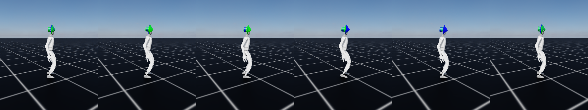
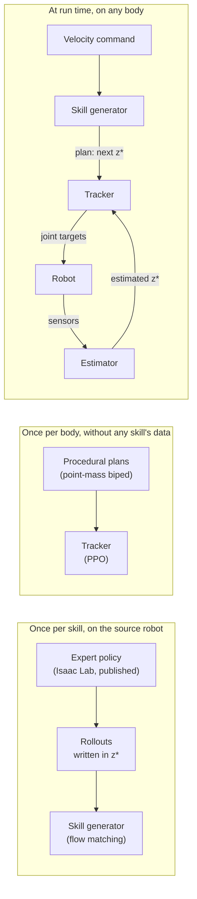

# Humanoid skill transfer through dimensionless contracts

A locomotion skill learned on one humanoid runs on a very different one that was never trained
on it. The source is the Unitree G1 (about 32 kg in simulation); the target is the NAO H25,
nine times lighter and 2.3 times shorter. Everything runs in Isaac Lab, in simulation.

<p align="center">
  
</p>

## The idea

A skill does not cross between bodies as joint angles: those depend on the body. It crosses as a
**contract**, the short future of a 27-number state `z*` that describes what a body does, not how
its joints move: centre-of-mass height and velocity, tilt, turn rate, where the feet are, how
much weight each foot carries, and angular momentum. Every quantity is made dimensionless with the
body's own leg length, mass and gravity, so the same gait is the same vector on a large robot and
on a small one (dynamic similarity, Buckingham's Π theorem).



- The **generator** of a skill is trained once, on the source robot's data only.
- Each body's **estimator** and **tracker** are trained once, on physically generated plans, and
  never see a transferred skill.
- `N` skills on `M` bodies cost `N + M` trainings instead of `N × M`.

The method is described in [`transfer/README.md`](transfer/README.md), with the network diagrams.

## Results

Three seeds per body, on the deployed path (the generator plans, the body estimates its own
state). The full tables are rebuilt by `python transfer/scripts/paper_tables.py`.

**Zero-shot transfer of Isaac Lab's two published G1 locomotion policies**
(`Isaac-Velocity-Flat-G1-v0`, `Isaac-Velocity-Rough-G1-v0`), three commands, 64 episodes each:

| Body | Skill | Episodes completed without a fall | Speed / teacher's |
| --- | --- | --- | --- |
| NAO | flat | 192 / 192 | 1.04–1.11 |
| NAO | rough | 192 / 192 | 1.00–1.04 |
| G1 | flat | 192 / 192 | 1.06–1.14 |
| G1 | rough | 192 / 192 | 1.00–1.05 |

**How close the gait stays to the teacher's.** Largest relative deviation of the gait signature
(stride length, stride period, duty factor of each foot), mean ± standard error over seeds, lower
is better (`python transfer/scripts/paper_bootstrap.py`):

| Body, skill | This method (zero-shot) | Tracker trained on the skill itself | Joint-angle imitation |
| --- | --- | --- | --- |
| NAO, rough | **0.141 ± 0.016** | 0.346 ± 0.010 | 0.195 ± 0.026 |
| NAO, flat | **0.185 ± 0.012** | 0.674 ± 0.017 | 0.307 ± 0.009 |
| G1, rough | 0.153 ± 0.004 | **0.072 ± 0.001** | — |
| G1, flat | 0.087 ± 0.003 | **0.063 ± 0.002** | — |

On the NAO, the zero-shot tracker stays closer to the teacher's gait than a tracker trained on
the skill's own plans, and than joint-angle imitation on flat ground (on rough the difference is
within the seeds' spread). On the G1 itself, training on the skill remains more accurate: the
benefit is across bodies. A NAO policy trained on the task directly with the G1's reward recipe
walks with a gait of its own, not the teacher's.

**A task held out of all training.** Sidestepping is left out of every generator and tracker;
the generator learns walking, flat, backward and jogging, the trackers walking, flat and jogging
(`python transfer/scripts/w20_compare.py`, `python transfer/scripts/w20_starts.py`):

| Body | Gait cost of holding it out | Runs completed, trackers trained on the base tasks | … plus cross-fitted plans |
| --- | --- | --- | --- |
| G1 | +0.019 ± 0.002 | 206 / 288 | **282 / 288** |
| NAO | +0.013 ± 0.005 | 203 / 288 | **288 / 288** |

Cross-fitted plans are plans of a base task drawn by a generator that never saw that task, so
the tracker practises plans it has not seen executed. On the G1 they cost a little on flat ground
(+0.011 ± 0.005).

**Limits.** Simulation only; one source and one target body; on the NAO, no command keeps every
feature of the gait signature within 10 % of the teacher's.

## Repository

```text
.
├── source/humanoid_transfer/   the Isaac Lab extension (all Python code)
│   └── humanoid_transfer/
│       ├── common/             body-independent theory: z*, units, centroidal dynamics, gait signature
│       ├── transfer/           the contract: generator, estimator, tracking task, evaluation
│       ├── g1/                 source robot: teacher and expert tasks, G1 tracking task
│       └── nao/                target robot: asset pipeline, NAO tracking task, baselines
├── transfer/                   scripts and results of the method (see transfer/README.md)
├── g1/                         the pinned teacher policy and the G1's body card
├── nao/                        the NAO's URDF, licences and asset scripts
├── scripts/                    train.py, play.py, list_tasks.py (they register this extension's tasks)
└── tests/                      run without Isaac Sim
```

Code organisation and its boundaries: [`ARCHITECTURE.md`](ARCHITECTURE.md).

## Setup

| Component | Version |
| --- | --- |
| Isaac Lab | 2.3.2 |
| Isaac Sim | 5.1.0 |
| rsl-rl-lib | 5.0.1 |
| PyTorch | 2.7.0+cu128 |

```powershell
python -m pip install -e source\humanoid_transfer
python nao\scripts\fetch_meshes.py      # NAO geometry; asks you to accept its licence
python -m pytest                        # no Isaac Sim needed
python scripts\list_tasks.py            # the tasks this extension registers
```

Tasks are registered by this repository's `scripts/train.py`, not by Isaac Lab's. The renderer
runs windowed.

## Reproducing

| Step | Command |
| --- | --- |
| A skill's generator, from its expert's rollouts | `python transfer/scripts/train_contract.py --name <skill> --data <rollouts.npz> ...` |
| A body's tracker | `python scripts/train.py --task G1Track-v0` or `NaoTrack-v0` (conditions in `transfer/scripts/paper_queue.sh`) |
| Evaluation on the deployed path | `ZS_TASK=<flat\|rough> bash transfer/scripts/zero_shot_ladder.sh <g1\|nao> <run> <checkpoint> <tag> l4` |
| Seeds and baselines | `bash transfer/scripts/paper_queue.sh`, `bash transfer/scripts/paper_baselines.sh` |
| Tables | `python transfer/scripts/paper_tables.py`, `python transfer/scripts/paper_bootstrap.py` |

The adopted models are listed in
[`transfer/results/incumbents.json`](transfer/results/incumbents.json); every result is a JSON
file in [`transfer/results/`](transfer/results/).

## Licensing

The project's own code is under [`LICENSE`](LICENSE). The NAO URDF is BSD 3-Clause; its meshes
are CC BY-NC-ND 4.0 and are never committed (they are fetched with the licence's assent). Details:
[`nao/assets/licenses/README.md`](nao/assets/licenses/README.md). **Non-commercial use only.**
