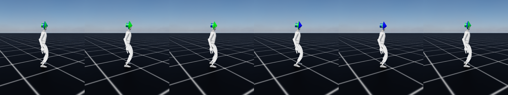

# `g1/`: the source robot

The Unitree G1 (23 actuated body joints, about 32 kg as loaded in Isaac Lab, leg length
0.655 m). Skills are learned on it first, because it can perform them; its model comes with
Isaac Lab and is not vendored here.



## The skills it provides

| Skill | Policy | Used for |
| --- | --- | --- |
| Flat, rough | Isaac Lab's published `Isaac-Velocity-Flat-G1-v0`, `Isaac-Velocity-Rough-G1-v0` | The skills transferred to the NAO |
| Walking | `G1Walk-Teacher-v0`: Isaac Lab's flat recipe with the command capped at 0.25 m/s, the speed Froude-matched to 0.15 m/s on the NAO | Pinned in [`policy/`](policy/README.md); its generator provides 30 % of the trackers' training plans |
| Backward, sidestep, jog | `G1Base-{Backward,Sidestep,Jog}-v0`: Isaac Lab's flat recipe, only the command range changed | The base tasks of the held-out-task setting |

Each policy's rollouts are captured in `z*` (`scripts/capture_rollouts.py`) and become the
training data of that skill's generator.

## What is here

| Path | Contents |
| --- | --- |
| `policy/` | The pinned walking teacher: TorchScript weights, provenance and hashes |
| `body/` | The G1's body card (leg length, mass, feet's sole geometry) and joint mirror map |
| `scripts/` | Capturing rollouts, measuring the body and the gait, rendering |
| `img/` | Figures |
| `rollouts/` | Captured rollouts, untracked (regenerable) |

The Python code is in `source/humanoid_transfer/humanoid_transfer/g1/`: the robot configuration
(`assets/`) and the tasks (`tasks/g1_walk`, `g1_base`, `g1_rough_flat`, `g1_track`).

```powershell
python scripts\train.py --task G1Walk-Teacher-v0 --headless --num_envs 4096
python g1\scripts\capture_rollouts.py --help
```
