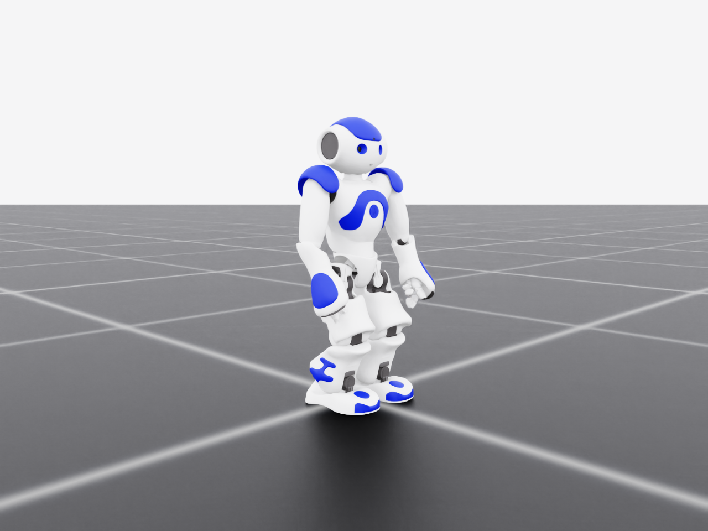

# `nao/`: the target robot

The NAO H25 V5.0 (SoftBank Robotics / Aldebaran): 5.3 kg, 0.58 m, weak actuators. It runs the
G1's skills through its own estimator and tracker, which never see those skills' data.



## Setup

The URDF is tracked (BSD 3-Clause); the meshes are CC BY-NC-ND 4.0 and are fetched once, after
the licence is accepted, and never committed. The USD is generated from them on first use.

```powershell
python nao\scripts\fetch_meshes.py                       # prompts for licence acceptance
python nao\scripts\view_asset.py --headless --max-steps 1  # loads the articulation and lets it fall
```

## Tasks

| Id | What it is |
| --- | --- |
| `NaoTrack-v0` | The NAO's tracker: follows plans of `z*` (see [`../transfer/README.md`](../transfer/README.md)) |
| `NaoVelocity{Flat,Rough}-v0` | Baseline: the NAO trained on the task itself with the G1's reward recipe, in the NAO's units |
| `NaoImitate-v0` | Baseline: the NAO imitating the G1's joint angles, retargeted to its own joints |
| `NaoStand-Direct-v0` | A separate study: zero-step balance under pushes |

## Body parameters

Derived from the URDF by `humanoid_transfer.nao.assets.nao_kinematics`, each covered by a test:

| Quantity | Value |
| --- | --- |
| Total mass | 5.3054 kg |
| CoM height above the soles | 0.2689 m |
| `ω₀ = √(g/z_c)` | 6.04 rad/s |
| Foot | 164.0 × 92.3 × 65.9 mm |

## What is here

| Path | Contents |
| --- | --- |
| `assets/urdf/` | The vendored URDF (tracked) |
| `assets/meshes/`, `assets/texture/`, `assets/generated/` | Licensed geometry and the generated USD (untracked) |
| `assets/licenses/` | Upstream licences and attribution |
| `body/` | The NAO's joint mirror map |
| `scripts/` | Asset fetching and checks, and the balance study's controllers and evaluation |
| `results/` | The balance study's results (JSON) |
| `img/` | Figures |

The Python code is in `source/humanoid_transfer/humanoid_transfer/nao/`: assets, controllers and
tasks.

## Licensing

See [`assets/licenses/README.md`](assets/licenses/README.md). **Non-commercial use only.**
