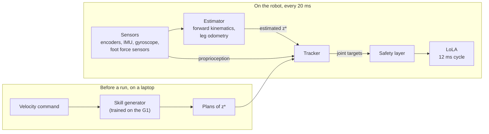
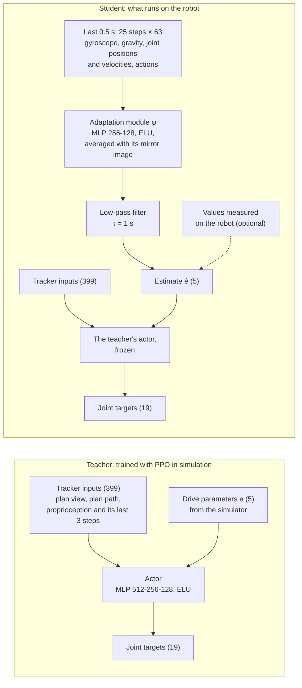

# `nao/`: the target robot

The NAO H25 V5.0 (SoftBank Robotics / Aldebaran): 5.3 kg, 0.58 m, weak actuators. It runs the
G1's skills through its own estimator and tracker, which never see those skills' data.


## Setup

The URDF is tracked (BSD 3-Clause); the meshes are CC BY-NC-ND 4.0 and are fetched once, after
the licence is accepted, and never committed. The USD is generated from them on first use.

```powershell
python nao\scripts\fetch_meshes.py                       # prompts for licence acceptance
python nao\scripts\view_asset.py --headless --max-steps 1  # loads the articulation and lets it fall
```

## Tasks

| Id | What it is |
| --- | --- |
| `NaoTrack-v0` | The NAO's tracker: follows plans of `z*` (see [`../transfer/README.md`](../transfer/README.md)) |
| `NaoTrack-Sim2Real-v0` | The same tracker on a model of the real robot (see [Running on a real NAO](#running-on-a-real-nao)) |
| `NaoTrack-Sim2RealTeacher-v0` | That task, with each robot's drive parameters given to the policy |
| `NaoTrack-Sim2RealStudent-v0` | The teacher's task, with the history the student estimates those parameters from |
| `NaoVelocity{Flat,Rough}-v0` | Baseline: the NAO trained on the task itself with the G1's reward recipe, in the NAO's units |
| `NaoImitate-v0` | Baseline: the NAO imitating the G1's joint angles, retargeted to its own joints |
| `NaoStand-Direct-v0` | A separate study: zero-step balance under pushes |

## Body parameters

Derived from the URDF by `humanoid_transfer.nao.assets.nao_kinematics`, each covered by a test:

| Quantity | Value |
| --- | --- |
| Total mass | 5.3054 kg |
| CoM height above the soles | 0.2689 m |
| `ω₀ = √(g/z_c)` | 6.04 rad/s |
| Foot | 164.0 × 92.3 × 65.9 mm |

## What is here

| Path | Contents |
| --- | --- |
| `assets/urdf/` | The vendored URDF (tracked) |
| `assets/meshes/`, `assets/texture/`, `assets/generated/` | Licensed geometry and the generated USD (untracked) |
| `assets/licenses/` | Upstream licences and attribution |
| `body/` | The NAO's joint mirror map; its motors' datasheet ratings (`motors.json`) |
| `bundles/` | Deployment bundles for the real robot (untracked: derived from the URDF) |
| `scripts/` | Asset fetching and checks; the balance study; the real robot's pipeline: legs' loads, sensitivity sweeps, training, bundles, parity, MuJoCo sim2sim, drive fit, packing |
| `results/` | Results as JSON |
| `img/` | Figures |

The Python code is in `source/humanoid_transfer/humanoid_transfer/nao/`: assets, controllers and
tasks; `sim2real/` (a real NAO's imperfections in simulation) and `deploy/` (the runtime that runs
on the robot).

## Running on a real NAO

The pipeline below is tested in simulation, in Isaac Lab and in MuJoCo; it has not yet run on a
physical robot.

The robot runs the tracker and its own estimate of `z*`. The plans are drawn beforehand, on a
laptop, by the same generator from the robot's standing state: in autonomous mode the generator
reads the body only when it starts. Everything the tracker reads comes from the robot's sensors:
the joint encoders, the IMU's roll and pitch, the gyroscope and each foot's four force sensors.
`z*` is computed from them by forward kinematics, with velocities measured from the foot in
stance (leg odometry). The robot runs the estimator in NumPy (`deploy/estimator.py`); training runs
a torch copy of it on the GPU (`sim2real/estimator_torch.py`), and a test keeps the two equal.



The runtime (`deploy/`) needs Python 3.7+ and NumPy, and nothing else from this repository. On a
robot without them, `deploy/relay.py` (Python 2.7 or 3, standard library only) forwards LoLA's
messages, and the runtime runs on a laptop over Ethernet.

### The robot in simulation

`NaoTrack-Sim2Real-v0` is `NaoTrack-v0` (the same plans, contract reward and terminations) on a
model of a real NAO. The actor reads only what the robot computes, through the robot's estimator,
plus its last 3 steps of proprioception and actions; the critic keeps the simulator's truth. One
body cost is added, the motors' heat. The ranges are `ROBOT_RANGES` in
`nao_track_sim2real_env_cfg.py`:

| Imperfection | Range |
| --- | --- |
| Latency from command to drive | 10–60 ms |
| Drive stiffness and damping | ×0.7–1.3 |
| Torque ceiling | ×0.7–1.1 |
| Rotor inertia reflected at the joint | ×0.5–1.5 |
| Sole friction | 0.5–1.3 (0.4–1.04 combined with the floor) |
| Link masses; mass added to the torso; torso CoM | ×0.95–1.05; 0–0.15 kg; ±1 cm |
| Encoders | offsets ±1.5°, 4096 counts per turn, velocity by finite differences |
| IMU tilt; gyroscope bias | ±1.5°; ±0.02 rad/s |
| Foot force sensors | gain ±15 %, offset ±0.03 `m g` |
| Pushes | up to 0.1 m/s, every 5–10 s |

### The policies

Three policies, each built on the one before:

| Policy | Task | Training |
| --- | --- | --- |
| Robot-trained tracker | `NaoTrack-Sim2Real-v0` | The adopted tracker (`r1_3498`), widened with zero weights for its new inputs, continued for 1500 PPO iterations (model 4997) |
| Teacher | `NaoTrack-Sim2RealTeacher-v0` | The robot-trained tracker, actor and critic widened for the drive parameters `e`, continued with PPO (model 5100) |
| Student | `NaoTrack-Sim2RealStudent-v0` | The teacher's actor, frozen, on an estimate of `e` from an adaptation module trained by regression |

`e` is five numbers: the latency, and the leg drives' stiffness, damping, torque ceiling and
rotor inertia, each normalised to [−1, 1] over the fixed ranges above. A real robot does not know
them, so the student estimates them from the last 0.5 s of what it sensed and did (rapid motor
adaptation, Kumar et al., 2021):



- **Teacher.** Its robots draw each drive factor once per robot, every joint within ±10 % of
  it, so that `e` describes the whole robot. The checkpoint used is the one about 100 iterations
  into training (model 5100). Trained longer, the teacher keeps improving on the procedural plans
  it trains on while it tracks the skill's plans, which it never sees, worse: at 35 ms the
  contract error is 0.48 at model 5100 and 0.69 at model 5996, against 0.53 for the robot-trained
  tracker (`results/adaptation_s2r_teacher_{5100,5996}.json`). The checkpoint was chosen among
  models 5000, 5100, 5300 and 5600 on two of the thirteen robots below (latency 35 and 10 ms); the
  other eleven are held out.
- **Adaptation module.** Regression of `ê` on the true `e`, 400 rounds, on rollouts the student
  itself drives; over the first 30 % of rounds, a share of the robots that falls from all to none
  is driven with the true `e` instead. The estimate is the average of `φ` on the history and on
  its mirror image, since the mirrored robot has the same parameters. Against the truth on its last
  round, `R²` is 0.96 for the latency, 0.63 stiffness, 0.49 damping, 0.56 torque ceiling and 0.18
  rotor inertia (`<student run>/rounds.json`).
- **Low-pass filter.** The parameters are constant over a run, but `φ`'s estimate moves with the
  gait's phase. `φ` also reads the actions its own estimate shapes, so the estimate feeds back on
  itself. A first-order filter with a 1 s time constant (`params_tau` in the bundle) keeps that
  loop stable. The exported TorchScript carries the same filter, so Isaac Lab evaluates the policy
  the robot runs.
- **Measured values.** `fit_actuators.py --params` writes the latency and drive factors
  identified on the robot; `run_policy --params` gives them to the student in place of its
  estimate, and a value the file leaves out stays estimated.

`check_runtime.py` replays each bundle's parity records, taken in Isaac Lab, through the NumPy
runtime, with the simulator's actions fed back. Observations and actions agree to 1e-4 for the
robot-trained tracker and for the student.

### Results in simulation

**In Isaac Lab.** Contract error on the flat skill's plans, 32 robots × 900 steps per setting,
standard error ≤ 0.024 (`evaluate_sim2real.sh`). "The robot as expected" combines a latency of
30–40 ms, encoder and IMU offsets of ±1°, a gyroscope bias, force-sensor errors, rotor inertia
×0.5–1.5, torque ceilings ×0.8–1.0, and the robot's estimator, odometry and force sensors.

| Setting | Adopted tracker | Robot-trained tracker | Student |
| --- | --- | --- | --- |
| Nominal simulator, forward 0.154 m/s | 0.357 | 0.632 | 0.614 |
| Nominal simulator, fast | 0.345 | 0.926 | 0.993 |
| Nominal simulator, turning | 0.376 | 0.805 | 0.837 |
| Latency 60 ms | 1.819 (72 % of robots fall) | 0.857 | 0.832 |
| The robot as expected, forward | 1.223 | 0.583 | 0.513 |
| The robot as expected, turning | 1.422 (1 robot of 32 falls) | 0.831 | 0.782 |

On the nominal simulator, the one it was trained in, the adopted tracker follows its plans most
closely. The robot model costs the other two accuracy there, with longer double support (duty
factor 0.83–0.84 against 0.58). All three walk at the commanded speed (0.120–0.121 m/s forward,
0.312–0.313 fast, 0.158–0.166 turning). Under the robot's imperfections the order reverses: the
adopted tracker's error more than triples and it falls at 60 ms, while the two policies trained on
the robot model fall in none of the sweep's twelve settings. The student follows its plans more
closely than the robot-trained tracker with the robot as expected (5.3 standard errors forward,
2.5 turning) and at 60 ms (3.9), and less closely on the nominal simulator's fast and turning
commands (11.5 and 6.2). The robot-trained policies also load the knees less. Their knee motor
sits at its torque ceiling on 27–40 % of steps, against 46–47 % for the adopted tracker, at an
RMS torque of 0.91–0.96 of its nominal rating, against 1.01–1.02 (`results/joint_load_*.json`).
What each imperfection costs, one at a time:


**What knowing the robot is worth.** Contract error on robots of fixed parameters, flat skill,
forward unless noted, 32 robots × 900 steps each, standard error ≤ 0.02, no fall on any
(`evaluate_adaptation.sh`). Each robot's drives are drawn as the teacher's are, one factor with
every joint within ±10 % of it. The teacher is shown told the truth, and told the nominal robot
(35 ms, every drive ×1) whatever it drives (`constant_params.py`).

| Robot | Robot-trained tracker | Teacher told the truth | Teacher told the nominal robot | Student |
| --- | --- | --- | --- | --- |
| Latency 35 ms, drives nominal | 0.534 | 0.483 | 0.479 | 0.477 |
| Latency 10 ms | 0.527 | 0.503 | 0.512 | 0.499 |
| Latency 60 ms | 0.899 | 0.882 | 0.874 | 0.880 |
| Torque ceilings ×0.7 | 0.570 | 0.456 | 0.492 | 0.458 |
| Torque ceilings ×1.1 | 0.537 | 0.493 | 0.484 | 0.482 |
| Stiffness ×0.7 | 0.584 | 0.512 | 0.519 | 0.499 |
| Stiffness ×1.3 | 0.574 | 0.527 | 0.520 | 0.526 |
| Rotor inertia ×0.5 | 0.534 | 0.488 | 0.489 | 0.486 |
| Rotor inertia ×1.5 | 0.539 | 0.473 | 0.475 | 0.470 |
| Everything weak, 60 ms | 0.865 | 0.825 | 0.856 | 0.821 |
| Everything strong, 10 ms | 0.543 | 0.539 | 0.543 | 0.535 |
| The robot as expected, forward | 0.580 | 0.515 | 0.525 | 0.513 |
| The robot as expected, turning | 0.834 | 0.789 | 0.794 | 0.791 |

The student does as well as the teacher told the truth, within 2.3 standard errors on every
robot. It is closer to its plans than the robot-trained tracker by more than 2 standard errors on
eleven of the thirteen; the two exceptions are "everything strong" (1.6) and the robot as
expected, turning (1.8). Most of that gain is the teacher's own. Told the nominal robot instead
of the truth, the teacher is worse by more than 2 standard errors only with weak motors (torque
ceilings ×0.7: 8.9; everything weak: 4.5) and at 10 ms (2.3). Across these robots the student
walks 7 % slower than the robot-trained tracker (0.107–0.122 against 0.113–0.130 m/s).

**In MuJoCo.** The robot's own runtime drives the robot from rest in a second physics engine
(`sim2sim_suite.py`). Each plan runs 20 times at each of four settings (sole friction 0.64 or
1.0, latency 0 or 36 ms), 80 runs per plan:

| Policy | Falls, forward | Falls, standing | Falls, turning | Falls, of 240 | Forward, 15 s run with 10 s of walking | Drift back, standing 12 s |
| --- | --- | --- | --- | --- | --- | --- |
| Adopted tracker | 45 | 53 | 53 | 151 | — | — |
| Robot-trained tracker | 5 | 0 | 31 | 36 | 0.75–1.04 m | 0.04–0.21 m |
| Student | 4 | 1 | 28 | 33 | 0.43–0.72 m | 0.24–0.50 m |
| Student told MuJoCo's latency and drives | 4 | 3 | 25 | 32 | 0.40–0.70 m | 0.24–0.51 m |

The adopted tracker falls in all 120 runs with latency. The two robot-trained policies fall
mostly when turning with latency. The student walks less far than the robot-trained tracker and
drifts further back while standing. Told MuJoCo's latency and drives, it does the same, so the
difference comes from the teacher, not from the estimate.

### On the robot

On a NAO V6 (NAOqi 2.8, LoLA), only one client may command the joints. NAOqi's own motion is
stopped first (`nao stop`, or `systemctl --user stop naoqi`) and restarted afterwards;
`check_sensors` fails cleanly if `/tmp/robocup` is not served. Unzip the packed runtime and bundle
on the robot and run the tools from that folder. Alternatively, run `deploy/relay.py` on the robot
and the tools on the laptop, with `--relay <robot ip>` in place of `--lola`.

| Step | Command | Robot |
| --- | --- | --- |
| Sensors | `python3 -m deploy.tools.check_sensors --lola --bundle bundle` | standing, still |
| Latency | `python3 -m deploy.tools.measure_delay --lola` | in its harness, feet free |
| Drives | `python3 -m deploy.tools.sysid_record --lola` | in its harness, feet free |
| Fit | `python nao/scripts/fit_actuators.py <record> --bundle <bundle> --output <fit> --card <card> --params <params>` | (PC) |
| Run | `python3 -m deploy.tools.run_policy --lola --bundle bundle --plan stand [--params <params>]` | in its harness, then free |

The student needs no retraining after the fit: it runs on its own estimate of the drives, or on
the fitted values with `--params`. The robot-trained tracker is retrained on the fitted robot
first:

```bash
HUMANOID_ROBOT_CARD=<card> bash nao/scripts/train_sim2real.sh 300 <name> <run>/model_4997.pt
```

A run ramps the stiffness up and moves to the crouch. It holds the crouch until the chest button
is pressed, once the robot has been set on its feet from its harness, then follows the plan and
returns to the crouch. The chest button, a tilt past 0.6 rad or a leg motor at 75 °C stops it; on
a fall every joint goes soft. Each run logs every control step, including the parameters it acted
on (`logs/run_<plan>_<time>.npz`).

### Reproducing

```bash
# The robot-trained tracker
bash nao/scripts/sensitivity.sh                    # what each imperfection costs the adopted tracker
bash nao/scripts/train_sim2real.sh 1500 s2r_r1
python nao/scripts/export_runtime.py --headless --policy <run>/exported/model_4997_sym.pt \
    --bundle nao/bundles/s2r_r1_4997               # actor, body model, plans, parity records

# The teacher and the student
bash nao/scripts/train_teacher.sh 1000 s2r_teacher
bash nao/scripts/train_student.sh <teacher>/model_5100.pt s2r_student_5100 -- --rounds 400
python nao/scripts/student_bundle.py <teacher>/model_5100.pt <student>/adaptation.pt \
    --like nao/bundles/s2r_r1_4997 --output nao/bundles/s2r_student_5100_tau1 \
    --torchscript <student>/exported/student_tau1.0.pt --params-tau 1
python nao/scripts/export_runtime.py --headless --policy <student>/exported/student_tau1.0.pt \
    --actor-npz nao/bundles/s2r_student_5100_tau1/actor.npz \
    --bundle nao/bundles/s2r_student_5100_tau1 --task-id NaoTrack-Sim2RealStudent-Play-v0

# Checks, and the package for the robot
python nao/scripts/check_runtime.py nao/bundles/<bundle>          # NumPy runtime against Isaac Lab
python nao/scripts/build_mjcf.py --bundle nao/bundles/<bundle>    # (an environment with mujoco)
python nao/scripts/sim2sim.py --bundle nao/bundles/<bundle> --plan forward --delay-ms 36
python nao/scripts/pack_robot.py nao/bundles/<bundle> --output nao/bundles/<bundle>_robot.zip

# The results above
bash nao/scripts/evaluate_sim2real.sh <adopted>/exported/model_3498_sym.pt r1_3498_sym_v3_eval NaoTrack-Play-v0
bash nao/scripts/evaluate_sim2real.sh <run>/exported/model_4997_sym.pt s2r_r1_4997
bash nao/scripts/evaluate_sim2real.sh <student>/exported/student_tau1.0.pt s2r_student_5100_tau1 \
    NaoTrack-Sim2RealStudent-Play-v0
bash nao/scripts/evaluate_adaptation.sh <run>/exported/model_4997_sym.pt s2r_r1_4997
bash nao/scripts/evaluate_adaptation.sh <teacher>/exported/model_5100_sym.pt s2r_teacher_5100 \
    NaoTrack-Sim2RealTeacher-Play-v0
python nao/scripts/constant_params.py <teacher>/exported/model_5100_sym.pt \
    <teacher>/exported/model_5100_sym_e_middle.pt --bundle nao/bundles/s2r_student_5100_tau1 \
    --params '{"delay_ms": 35, "stiffness_scale": 1, "damping_scale": 1, "effort_scale": 1, "armature_scale": 1}'
bash nao/scripts/evaluate_adaptation.sh <teacher>/exported/model_5100_sym_e_middle.pt \
    s2r_teacher_5100_e_middle NaoTrack-Sim2RealTeacher-Play-v0
bash nao/scripts/evaluate_adaptation.sh <student>/exported/student_tau1.0.pt s2r_student_5100_tau1 \
    NaoTrack-Sim2RealStudent-Play-v0
python nao/scripts/compare_sweeps.py nao/results/sensitivity_s2r_r1_4997.json \
    nao/results/sensitivity_s2r_student_5100_tau1.json \
    --output nao/results/compare_4997_s2r_student_5100_tau1_sim2real.json
python nao/scripts/compare_sweeps.py nao/results/adaptation_s2r_r1_4997.json \
    nao/results/adaptation_s2r_student_5100_tau1.json \
    --output nao/results/compare_4997_s2r_student_5100_tau1.json
python nao/scripts/compare_sweeps.py nao/results/adaptation_s2r_teacher_5100_e_middle.json \
    nao/results/adaptation_s2r_teacher_5100.json --output nao/results/compare_teacher_5100_e_value.json
python nao/scripts/compare_sweeps.py nao/results/adaptation_s2r_teacher_5100.json \
    nao/results/adaptation_s2r_student_5100_tau1.json
python nao/scripts/sensitivity_figure.py nao/results/sensitivity_r1_3498_sym_v3.json \
    nao/results/sensitivity_s2r_r1_4997.json --labels "adopted tracker" "trained on the robot model" \
    --output nao/img/sensitivity.png
python nao/scripts/sim2sim_suite.py nao/bundles/<bundle> --runs 20 --output nao/results/sim2sim_<bundle>_s20.json
python nao/scripts/sim2sim_suite.py nao/bundles/s2r_student_5100_tau1 --runs 20 --tell-latency \
    --params <every drive factor 1>.json --output nao/results/sim2sim_s2r_student_5100_told_nominal_s20.json
```

## Licensing

See [`assets/licenses/README.md`](assets/licenses/README.md). **Non-commercial use only.**
