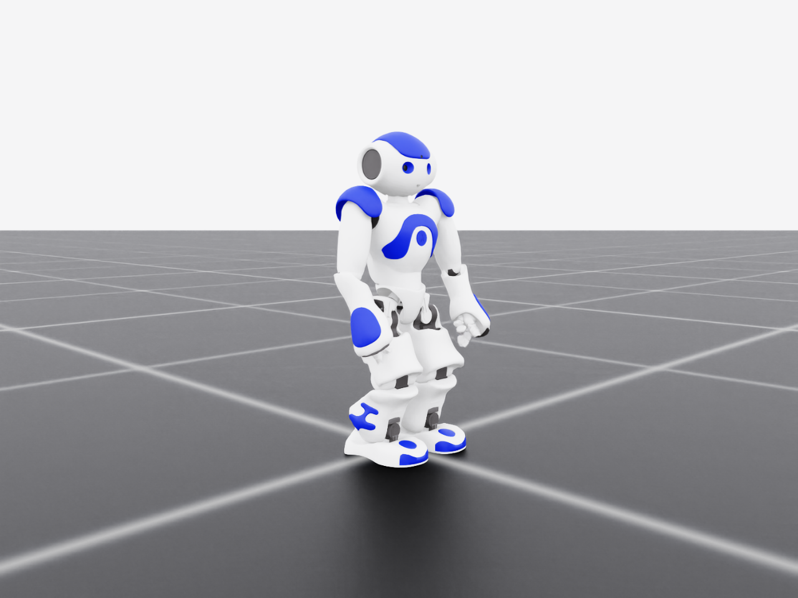

# `nao/`: the target robot

The NAO H25 V5.0 (SoftBank Robotics / Aldebaran): 5.3 kg, 0.58 m, weak actuators. It runs the
G1's skills through its own estimator and tracker, which never see those skills' data.



## Setup

The URDF is tracked (BSD 3-Clause); the meshes are CC BY-NC-ND 4.0 and are fetched once, after
the licence is accepted, and never committed. The USD is generated from them on first use.

```powershell
python nao\scripts\fetch_meshes.py                       # prompts for licence acceptance
python nao\scripts\view_asset.py --headless --max-steps 1  # loads the articulation and lets it fall
```

## Tasks

| Id | What it is |
| --- | --- |
| `NaoTrack-v0` | The NAO's tracker: follows plans of `z*` (see [`../transfer/README.md`](../transfer/README.md)) |
| `NaoTrack-Sim2Real-v0` | The same tracker trained on a model of the real robot (see "Running on a real NAO") |
| `NaoTrack-Sim2RealTeacher-v0` | That tracker told each robot's drive parameters (see "Without the retrain") |
| `NaoTrack-Sim2RealStudent-v0` | The teacher's task with the history the student's adaptation module reads |
| `NaoVelocity{Flat,Rough}-v0` | Baseline: the NAO trained on the task itself with the G1's reward recipe, in the NAO's units |
| `NaoImitate-v0` | Baseline: the NAO imitating the G1's joint angles, retargeted to its own joints |
| `NaoStand-Direct-v0` | A separate study: zero-step balance under pushes |

## Body parameters

Derived from the URDF by `humanoid_transfer.nao.assets.nao_kinematics`, each covered by a test:

| Quantity | Value |
| --- | --- |
| Total mass | 5.3054 kg |
| CoM height above the soles | 0.2689 m |
| `ω₀ = √(g/z_c)` | 6.04 rad/s |
| Foot | 164.0 × 92.3 × 65.9 mm |

## What is here

| Path | Contents |
| --- | --- |
| `assets/urdf/` | The vendored URDF (tracked) |
| `assets/meshes/`, `assets/texture/`, `assets/generated/` | Licensed geometry and the generated USD (untracked) |
| `assets/licenses/` | Upstream licences and attribution |
| `body/` | The NAO's joint mirror map; its motors' datasheet ratings (`motors.json`) |
| `bundles/` | Deployment bundles for the real robot (untracked: derived from the URDF) |
| `scripts/` | Asset fetching and checks, the balance study's controllers and evaluation, the legs' loads against the motors (`static_torque.py`, `joint_load.sh`), and the real robot's pipeline: sensitivity sweep, training, bundles, parity, MuJoCo sim2sim, drive fit, packing |
| `results/` | The balance study's results, the legs' loads, the sensitivity sweeps and the MuJoCo sim2sim suites (JSON) |
| `img/` | Figures |

The Python code is in `source/humanoid_transfer/humanoid_transfer/nao/`: assets, controllers and
tasks; `sim2real/` (a real NAO's imperfections in simulation) and `deploy/` (the runtime that runs
on the robot).

## Running on a real NAO

What runs on the robot is the tracker and the robot's own estimate of `z*`; the plans are drawn
beforehand, on a laptop, by the same generator from the robot's standing state (in autonomous
mode the generator reads the body only when it starts). The tracker's inputs come from the
robot's sensors only: joint encoders, the IMU's roll and pitch, the gyroscope, and each foot's four
force sensors. `z*` is computed from them by forward kinematics, with velocities measured from the
loaded foot (leg odometry) — the same NumPy code in training (`NaoTrack-Sim2Real-v0`) and on the
robot (`deploy/estimator.py`). The runtime needs Python 3.7+ and NumPy; a robot without them runs
`deploy/relay.py` (Python 2.7 or 3, standard library) and the runtime runs on a laptop over
Ethernet.

**On the PC.**

```bash
bash nao/scripts/sensitivity.sh                    # what each imperfection costs the tracker
bash nao/scripts/train_sim2real.sh 1000 s2r_r1     # the tracker, continued on the robot model
python nao/scripts/export_runtime.py --headless --policy <run>/exported/<model>_sym.pt \
    --bundle nao/bundles/<name>                    # actor, body model, plans, parity records
python nao/scripts/check_runtime.py nao/bundles/<name>          # NumPy runtime == simulator
python nao/scripts/build_mjcf.py --bundle nao/bundles/<name>    # (env with mujoco)
python nao/scripts/sim2sim.py --bundle nao/bundles/<name> --plan forward --delay-ms 36
python nao/scripts/pack_robot.py nao/bundles/<name> --output nao/bundles/<name>_robot.zip
```

**On the robot** (NAOqi 2.8 / LoLA, a NAO V6: only one client may command the joints, so NAOqi's
own motion is stopped first — `nao stop`, or `systemctl --user stop naoqi` — and restarted after;
`check_sensors` fails cleanly if `/tmp/robocup` is not served). Unzip the packed runtime and
bundle on the robot and run the tools from that folder, or run `deploy/relay.py` there and the
tools on the laptop with `--relay <robot ip>` instead of `--lola`.

| Step | Command | Robot |
| --- | --- | --- |
| Sensors | `python3 -m deploy.tools.check_sensors --lola --bundle bundle` | standing, still |
| Latency | `python3 -m deploy.tools.measure_delay --lola` | in its harness, feet free |
| Drives | `python3 -m deploy.tools.sysid_record --lola` | in its harness, feet free |
| Fit | `python nao/scripts/fit_actuators.py <record> --bundle <bundle> --output <fit> --card <card>` | (PC) |
| Retrain | `HUMANOID_ROBOT_CARD=<card> bash nao/scripts/train_sim2real.sh 300 <name> <run>/model_<n>.pt` | (PC) |
| Run | `python3 -m deploy.tools.run_policy --lola --bundle bundle --plan stand` | in its harness, then free |
| Run a student, measured | `python3 -m deploy.tools.run_policy --lola --bundle bundle --plan stand --params <params>` | in its harness, then free |

A student's bundle (below) skips the retrain: it runs on its own estimate of the drives, or on
the values the fit writes (`fit_actuators.py --params <params>`: latency and each drive factor;
a parameter the file leaves out keeps the estimate). Each run logs what it acted on.

A run ramps the stiffness, moves to the crouch, holds it until the chest button is pressed (the
robot is set on its feet from its harness first), follows the plan and returns to the crouch; the
chest button, a tilt past 0.6 rad or a leg motor at 75 °C stops it, and on a fall every joint goes
soft. Each run is logged (`logs/run_<plan>_<time>.npz`).

### Results in simulation

The adopted tracker (`zs_nao_r1`, model 3498, symmetrised) against the same tracker continued
for 1500 iterations on `NaoTrack-Sim2Real-v0` (`s2r_r1`, model 4997), on the flat skill's plans,
32 robots × 900 steps per setting; ± is the standard error over robots.

| Setting (Isaac Lab) | Adopted: falls / 1000 steps | contract error | Robot-trained: falls / 1000 steps | contract error |
| --- | --- | --- | --- | --- |
| Nominal simulator, forward 0.154 m/s | 0 | 0.36 ± 0.00 | 0 | 0.63 ± 0.00 |
| Latency 60 ms | 1.32 ± 0.22 (72 % of robots fall) | 1.82 ± 0.02 | 0 | 0.86 ± 0.00 |
| Everything expected of the robot, forward | 0 | 1.22 ± 0.02 | 0 | 0.58 ± 0.01 |
| Everything expected of the robot, turning | 0.03 ± 0.03 | 1.42 ± 0.02 | 0 | 0.83 ± 0.01 |

Both walk at the commanded speed on the nominal simulator (0.120 and 0.121 m/s forward, 0.312
and 0.313 m/s fast, 0.166 and 0.158 m/s turning). The robot-trained tracker follows its plans less
closely there, with longer double support (duty factor 0.84 against 0.58), and loads its knees less:
the knee motor sits at its torque ceiling on 27–39 % of steps against 46–47 %, at an RMS torque of
0.91–0.95 of its nominal rating against 1.01–1.02 (`nao/results/joint_load_*.json`).
What each imperfection costs, one at a time:


In MuJoCo (`nao/scripts/sim2sim_suite.py`: the robot's own runtime from rest, 20 runs at each of
sole friction 0.64 and 1.0 and latency 0 and 36 ms), the adopted tracker falls in 151 of 240
runs, all 120 with latency among them; the robot-trained one in 36 of 240: 5 of 80 walking
forward, 0 of 80 standing, 31 of 80 turning (27 of the 40 turning with latency). The first
version of this paragraph used 5 runs per setting (39 and 6 of 60): too few to rank fall rates of
this size, and it understated the turning risk. The NumPy runtime reproduces the simulator's
observations and actions to 1e-4 over each bundle's parity records (`nao/scripts/check_runtime.py`).

```bash
bash nao/scripts/evaluate_sim2real.sh <run>/exported/model_4997_sym.pt s2r_r1_4997
bash nao/scripts/evaluate_sim2real.sh <adopted>/exported/model_3498_sym.pt r1_3498_sym_v3_eval NaoTrack-Play-v0
python nao/scripts/sensitivity_figure.py nao/results/sensitivity_r1_3498_sym_v3.json \
    nao/results/sensitivity_s2r_r1_4997.json --labels "adopted tracker" "trained on the robot model" \
    --output nao/img/sensitivity.png
python nao/scripts/sim2sim_suite.py nao/bundles/s2r_r1_4997 --runs 20 \
    --output nao/results/sim2sim_s2r_r1_4997_s20.json
python nao/scripts/sim2sim_suite.py nao/bundles/r1_3498_sym --runs 20 \
    --output nao/results/sim2sim_r1_3498_sym_s20.json
```

### Without the retrain: a student that estimates the robot

The retrain adapts the tracker to the fitted drives. A student needs none. Its teacher is the
robot-trained tracker told each robot's drive parameters (`robot_params`: latency, stiffness,
damping, torque ceiling and rotor inertia, each normalised over the fixed ranges of
`ROBOT_RANGES`), trained on robots whose drives are drawn as one factor each, every joint within
±10 % of it. The student is that teacher, frozen, acting on an estimate of the parameters by an
adaptation module that reads the last 0.5 s of the robot's readings and actions (rapid motor
adaptation), fitted by regression on its own rollouts. Its estimate, against the truth over
its last training round: R² 0.96 for the latency, 0.63 stiffness, 0.49 damping, 0.56 torque
ceiling, 0.18 rotor inertia (`<student>/rounds.json`).

```bash
bash nao/scripts/train_teacher.sh 1000 s2r_teacher       # model_5100, its first 100 iterations
bash nao/scripts/train_student.sh <teacher>/model_5100.pt s2r_student_5100 -- --rounds 400
python nao/scripts/student_bundle.py <teacher>/model_5100.pt <student>/adaptation.pt \
    --like nao/bundles/s2r_r1_4997 --output nao/bundles/<name> \
    --torchscript <student>/exported/student_tau1.0.pt --params-tau 1
python nao/scripts/export_runtime.py --headless --policy <student>/exported/student_tau1.0.pt \
    --actor-npz nao/bundles/<name>/actor.npz --bundle nao/bundles/<name> \
    --task-id NaoTrack-Sim2RealStudent-Play-v0
python nao/scripts/check_runtime.py nao/bundles/<name>
```

Two choices the results below rest on:

- **The teacher is checkpoint 5100**, 100 iterations into the run. Continued, PPO keeps
  improving on the procedural plans it trains on while tracking the skill's plans, which it never
  sees, worse: contract error at 35 ms 0.48 at model 5100 and 0.69 at model 5996, against 0.53
  for 4997 (`nao/results/adaptation_s2r_teacher_{5100,5996}.json`). Model 5100 was picked among
  5000, 5100, 5300 and 5600 on the 35 ms and 10 ms settings below; the other eleven are held out.
- **The estimate is low-passed** with a 1 s time constant (`params_tau` in the bundle's
  `runtime.json`; the TorchScript keeps the same state, so Isaac evaluates the policy the robot
  runs). The parameters are constant over a run; the estimate moves with the gait's phase and,
  because the module reads the actions it shapes, with itself. Replayed on its own actions over
  the simulator's recorded sensors, the unfiltered student's actions drift from the simulator's by
  up to 0.64 while every sensed input agrees to 1e-4; filtered, by 1.0e-3. `check_runtime.py`
  therefore also replays with the simulator's actions fed back, and gates on that (3.2e-5 for
  this bundle).

Contract error on robots of fixed parameters, flat skill plans, forward (turning where said),
32 robots × 900 steps each, standard error ≤ 0.02, no fall in any
(`nao/scripts/evaluate_adaptation.sh`). "Told the nominal robot" is the same teacher reading
35 ms and every drive ×1 whatever it drives (`nao/scripts/constant_params.py`): what knowing the
robot is worth.

| Robot (Isaac Lab) | Robot-trained (4997) | Teacher told the truth | Teacher told the nominal robot | Student |
| --- | --- | --- | --- | --- |
| Latency 35 ms, drives nominal | 0.534 | 0.483 | 0.479 | 0.477 |
| Latency 10 ms | 0.527 | 0.503 | 0.512 | 0.499 |
| Latency 60 ms | 0.899 | 0.882 | 0.874 | 0.880 |
| Torque ceilings ×0.7 | 0.570 | 0.456 | 0.492 | 0.458 |
| Torque ceilings ×1.1 | 0.537 | 0.493 | 0.484 | 0.482 |
| Stiffness ×0.7 | 0.584 | 0.512 | 0.519 | 0.499 |
| Stiffness ×1.3 | 0.574 | 0.527 | 0.520 | 0.526 |
| Rotor inertia ×0.5 | 0.534 | 0.488 | 0.489 | 0.486 |
| Rotor inertia ×1.5 | 0.539 | 0.473 | 0.475 | 0.470 |
| Everything weak, 60 ms | 0.865 | 0.825 | 0.856 | 0.821 |
| Everything strong, 10 ms | 0.543 | 0.539 | 0.543 | 0.535 |
| The robot expected, forward | 0.580 | 0.515 | 0.525 | 0.513 |
| The robot expected, turning | 0.834 | 0.789 | 0.794 | 0.791 |

The student follows its plans as closely as the teacher told the truth (within 2.3 standard
errors everywhere), and more closely than 4997 by more than 2 standard errors on eleven robots
(not "everything strong", 1.6, nor the robot expected turning, 1.8). Most of that gain over 4997
is the teacher's, not the conditioning's: told the nominal robot, the teacher is worse than told
the truth by more than 2 standard errors only at 10 ms (2.3) and with weak motors (torque ×0.7,
8.9; everything weak, 4.5). On the settings of `evaluate_sim2real.sh` neither falls; the
student's contract error is lower than 4997's nominally (0.614 against 0.632), at the robot
expected (0.513 against 0.583 forward, 0.782 against 0.831 turning), with latency, weak motors,
heavy rotors and low friction, and higher on the paper's fast (0.993 against 0.926) and turning
(0.837 against 0.805) commands (`nao/results/compare_4997_s2r_student_5100_tau1_sim2real.json`).

In MuJoCo, 240 runs as above, the student falls in 33 (4 forward, 1 standing, 28 turning)
against 4997's 36; the teacher told MuJoCo's nominal drives and its latency, in 32. The student
walks less far: 0.65–0.72 m forward in the 10 s of walking at sole friction 0.64 and 0.43–0.63 m
at 1.0, against 0.90–1.04 m and 0.75–0.99 m for 4997; standing, it drifts back 0.24–0.50 m over
the 12 s against 0.04–0.21 m. The teacher told MuJoCo's drives does the same, so the drift is the
teacher's. In Isaac Lab it walks 7 % slower than 4997 on average (0.107–0.122 against
0.113–0.130 m/s on the robots above).

```bash
bash nao/scripts/evaluate_adaptation.sh <student>/exported/student_tau1.0.pt s2r_student_5100_tau1 \
    NaoTrack-Sim2RealStudent-Play-v0
bash nao/scripts/evaluate_sim2real.sh <student>/exported/student_tau1.0.pt s2r_student_5100_tau1 \
    NaoTrack-Sim2RealStudent-Play-v0
python nao/scripts/compare_sweeps.py nao/results/adaptation_s2r_r1_4997.json \
    nao/results/adaptation_s2r_student_5100_tau1.json
python nao/scripts/sim2sim_suite.py nao/bundles/s2r_student_5100_tau1 --runs 20 \
    --output nao/results/sim2sim_s2r_student_5100_tau1_s20.json
python nao/scripts/sim2sim_suite.py nao/bundles/s2r_student_5100_tau1 --runs 20 --tell-latency \
    --params <every drive factor 1>.json --output nao/results/sim2sim_s2r_student_5100_told_nominal_s20.json
```

## Licensing

See [`assets/licenses/README.md`](assets/licenses/README.md). **Non-commercial use only.**
