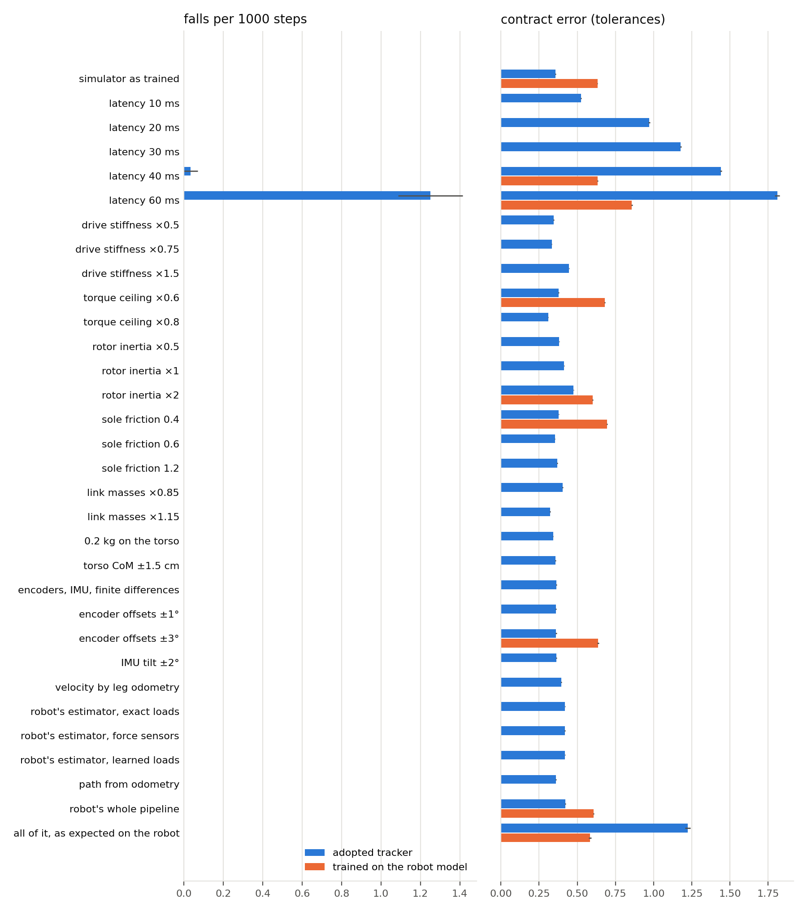

# `nao/`: the target robot

The NAO H25 V5.0 (SoftBank Robotics / Aldebaran): 5.3 kg, 0.58 m, weak actuators. It runs the
G1's skills through its own estimator and tracker, which never see those skills' data.


## Setup

The URDF is tracked (BSD 3-Clause); the meshes are CC BY-NC-ND 4.0 and are fetched once, after
the licence is accepted, and never committed. The USD is generated from them on first use.

```powershell
python nao\scripts\fetch_meshes.py                       # prompts for licence acceptance
python nao\scripts\view_asset.py --headless --max-steps 1  # loads the articulation and lets it fall
```

## Tasks

| Id | What it is |
| --- | --- |
| `NaoTrack-v0` | The NAO's tracker: follows plans of `z*` (see [`../transfer/README.md`](../transfer/README.md)) |
| `NaoTrack-Sim2Real-v0` | The same tracker trained on a model of the real robot (see "Running on a real NAO") |
| `NaoVelocity{Flat,Rough}-v0` | Baseline: the NAO trained on the task itself with the G1's reward recipe, in the NAO's units |
| `NaoImitate-v0` | Baseline: the NAO imitating the G1's joint angles, retargeted to its own joints |
| `NaoStand-Direct-v0` | A separate study: zero-step balance under pushes |

## Body parameters

Derived from the URDF by `humanoid_transfer.nao.assets.nao_kinematics`, each covered by a test:

| Quantity | Value |
| --- | --- |
| Total mass | 5.3054 kg |
| CoM height above the soles | 0.2689 m |
| `ω₀ = √(g/z_c)` | 6.04 rad/s |
| Foot | 164.0 × 92.3 × 65.9 mm |

## What is here

| Path | Contents |
| --- | --- |
| `assets/urdf/` | The vendored URDF (tracked) |
| `assets/meshes/`, `assets/texture/`, `assets/generated/` | Licensed geometry and the generated USD (untracked) |
| `assets/licenses/` | Upstream licences and attribution |
| `body/` | The NAO's joint mirror map; its motors' datasheet ratings (`motors.json`) |
| `bundles/` | Deployment bundles for the real robot (untracked: derived from the URDF) |
| `scripts/` | Asset fetching and checks, the balance study's controllers and evaluation, the legs' loads against the motors (`static_torque.py`, `joint_load.sh`), and the real robot's pipeline: sensitivity sweep, training, bundles, parity, MuJoCo sim2sim, drive fit, packing |
| `results/` | The balance study's results, the legs' loads, the sensitivity sweeps and the MuJoCo sim2sim suites (JSON) |
| `img/` | Figures |

The Python code is in `source/humanoid_transfer/humanoid_transfer/nao/`: assets, controllers and
tasks; `sim2real/` (a real NAO's imperfections in simulation) and `deploy/` (the runtime that runs
on the robot).

## Running on a real NAO

What runs on the robot is the tracker and the robot's own estimate of `z*`; the plans are drawn
beforehand, on a laptop, by the same generator from the robot's standing state (in autonomous
mode the generator reads the body only when it starts). The tracker's inputs come from the
robot's sensors only: joint encoders, the IMU's roll and pitch, the gyroscope, and each foot's four
force sensors. `z*` is computed from them by forward kinematics, with velocities measured from the
loaded foot (leg odometry) — the same NumPy code in training (`NaoTrack-Sim2Real-v0`) and on the
robot (`deploy/estimator.py`). The runtime needs Python 3.7+ and NumPy; a robot without them runs
`deploy/relay.py` (Python 2.7 or 3, standard library) and the runtime runs on a laptop over
Ethernet.

**On the PC.**

```bash
bash nao/scripts/sensitivity.sh                    # what each imperfection costs the tracker
bash nao/scripts/train_sim2real.sh 1000 s2r_r1     # the tracker, continued on the robot model
python nao/scripts/export_runtime.py --headless --policy <run>/exported/<model>_sym.pt \
    --bundle nao/bundles/<name>                    # actor, body model, plans, parity records
python nao/scripts/check_runtime.py nao/bundles/<name>          # NumPy runtime == simulator
python nao/scripts/build_mjcf.py --bundle nao/bundles/<name>    # (env with mujoco)
python nao/scripts/sim2sim.py --bundle nao/bundles/<name> --plan forward --delay-ms 36
python nao/scripts/pack_robot.py nao/bundles/<name> --output nao/bundles/<name>_robot.zip
```

**On the robot** (NAOqi 2.8 / LoLA, a NAO V6: only one client may command the joints, so NAOqi's
own motion is stopped first — `nao stop`, or `systemctl --user stop naoqi` — and restarted after;
`check_sensors` fails cleanly if `/tmp/robocup` is not served). Unzip the packed runtime and
bundle on the robot and run the tools from that folder, or run `deploy/relay.py` there and the
tools on the laptop with `--relay <robot ip>` instead of `--lola`.

| Step | Command | Robot |
| --- | --- | --- |
| Sensors | `python3 -m deploy.tools.check_sensors --lola --bundle bundle` | standing, still |
| Latency | `python3 -m deploy.tools.measure_delay --lola` | in its harness, feet free |
| Drives | `python3 -m deploy.tools.sysid_record --lola` | in its harness, feet free |
| Fit | `python nao/scripts/fit_actuators.py <record> --bundle <bundle> --output <fit> --card <card>` | (PC) |
| Retrain | `HUMANOID_ROBOT_CARD=<card> bash nao/scripts/train_sim2real.sh` | (PC) |
| Run | `python3 -m deploy.tools.run_policy --lola --bundle bundle --plan stand` | in its harness, then free |

A run ramps the stiffness, moves to the crouch, holds it until the chest button is pressed (the
robot is set on its feet from its harness first), follows the plan and returns to the crouch; the
chest button, a tilt past 0.6 rad or a leg motor at 75 °C stops it, and on a fall every joint goes
soft. Each run is logged (`logs/run_<plan>_<time>.npz`).

### Results in simulation

The adopted tracker (`zs_nao_r1`, model 3498, symmetrised) against the same tracker continued
for 1500 iterations on `NaoTrack-Sim2Real-v0` (`s2r_r1`, model 4997), on the flat skill's plans,
32 robots × 900 steps per setting; ± is the standard error over robots.

| Setting (Isaac Lab) | Adopted: falls / 1000 steps | contract error | Robot-trained: falls / 1000 steps | contract error |
| --- | --- | --- | --- | --- |
| Nominal simulator, forward 0.154 m/s | 0 | 0.36 ± 0.00 | 0 | 0.63 ± 0.00 |
| Latency 60 ms | 1.32 ± 0.22 (72 % of robots fall) | 1.82 ± 0.02 | 0 | 0.86 ± 0.00 |
| Everything expected of the robot, forward | 0 | 1.22 ± 0.02 | 0 | 0.58 ± 0.01 |
| Everything expected of the robot, turning | 0.03 ± 0.03 | 1.42 ± 0.02 | 0 | 0.83 ± 0.01 |

Both walk at the commanded speed on the nominal simulator (0.120 and 0.121 m/s forward, 0.312
and 0.313 m/s fast, 0.166 and 0.158 m/s turning). The robot-trained tracker follows its plans less
closely there, with longer double support (duty factor 0.84 against 0.58), and loads its knees less:
the knee motor sits at its torque ceiling on 27–39 % of steps against 46–47 %, at an RMS torque of
0.91–0.95 of its nominal rating against 1.01–1.02 (`nao/results/joint_load_*.json`).
What each imperfection costs, one at a time:



In MuJoCo (`nao/scripts/sim2sim_suite.py`: the robot's own runtime from rest, 5 runs at each of
sole friction 0.64 and 1.0 and latency 0 and 36 ms), the adopted tracker falls in 39 of 60 runs,
every one with latency; the robot-trained one in 6 of 60: 1 of 20 walking forward, 0 of 20
standing, 5 of 20 turning. The NumPy runtime reproduces the simulator's observations and actions
to 1e-4 over each bundle's parity records (`nao/scripts/check_runtime.py`).

```bash
bash nao/scripts/evaluate_sim2real.sh <run>/exported/model_4997_sym.pt s2r_r1_4997
bash nao/scripts/evaluate_sim2real.sh <adopted>/exported/model_3498_sym.pt r1_3498_sym_v3_eval NaoTrack-Play-v0
python nao/scripts/sensitivity_figure.py nao/results/sensitivity_r1_3498_sym_v3.json \
    nao/results/sensitivity_s2r_r1_4997.json --labels "adopted tracker" "trained on the robot model" \
    --output nao/img/sensitivity.png
python nao/scripts/sim2sim_suite.py nao/bundles/s2r_r1_4997 --output nao/results/sim2sim_s2r_r1_4997.json
```

## Licensing

See [`assets/licenses/README.md`](assets/licenses/README.md). **Non-commercial use only.**
