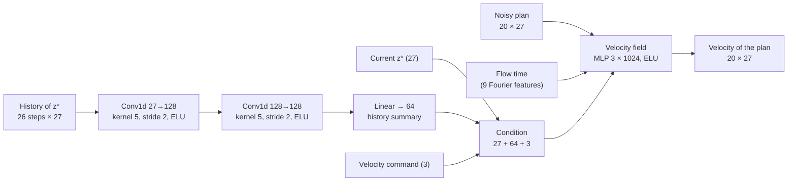
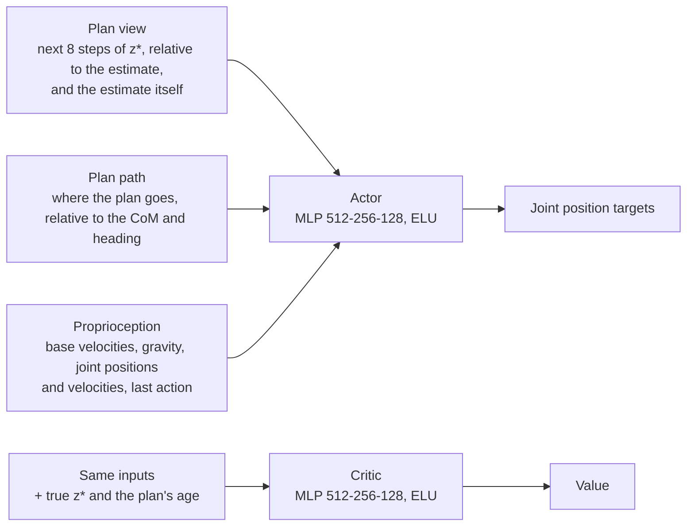
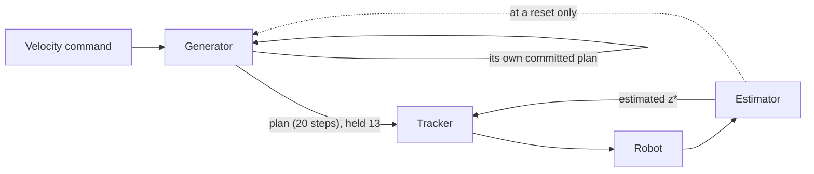

# The method

A skill crosses between bodies as a **contract**: a short plan of the dimensionless state `z*`.
A generator, trained once per skill on the source robot, writes the plan; each body follows it
with its own estimator and tracker, trained once per body without any skill's data.

## The shared state `z*`

27 numbers, each made dimensionless with the body's own units: length `L` (hip-pitch joint to
sole), mass `m` and gravity `g`, hence time `√(L/g)` and speed `√(gL)`. Dynamically similar
motions of different bodies then give the same `z*`.

| Field | Size | Frame |
| --- | --- | --- |
| Centre-of-mass height | 1 | above the ground |
| Centre-of-mass velocity | 3 | heading frame |
| Gravity direction | 3 | base frame |
| Base angular velocity | 3 | base frame |
| Foot positions | 6 | relative to the CoM, heading frame |
| Foot velocities | 6 | heading frame |
| Foot loads, `f_z / (m g)` | 2 | — |
| Centroidal angular momentum | 3 | heading frame |

Code: `common/skill_state.py` (NumPy, tested against Isaac Sim's own quantities) and
`transfer/latent/skill_torch.py` (the same on the GPU).

## The skill generator (once per skill)

A conditional flow-matching model. It reads the recent history of `z*` and the velocity command,
and samples the next 20 steps of `z*` on a fixed grid of dimensionless time (one step is
0.077 `√(L/g)`, the G1's control step).

- **Sampling:** the velocity field is integrated from Gaussian noise in 8 midpoint steps. The
  feet's loads are modelled in a warped (logarithmic) space, where light contact is resolved.
- **Training:** on rollouts of the source robot's expert written in `z*`, 1000 epochs, batch
  4096, learning rate 1e-3. The history is corrupted with the estimator's measured error, so the
  generator is trained on what a body will actually report; the rough-terrain generator also
  reads that noise level.
- **Adopted generators:** `flat_dagger2` (flat) and `rough_b4` (rough), trained on the G1 only.

Code: `transfer/latent/contract.py`, `transfer/latent/memory.py`;
`transfer/scripts/train_contract.py`.

## The estimator (once per body)

The kinematic part of `z*` (CoM, feet, velocities, tilt) is computed from the robot's link
states and kinematic model, with the sole height taken from each foot's lowest corner. The two
foot loads come from a learned encoder, an MLP over 120 proprioceptive inputs.

Code: `transfer/latent/skill_torch.py` (`proprioceptive_skill_state`),
`transfer/tasks/tracking/command.py`.

## The tracker (once per body)

A PPO policy that turns the plan into joint position targets. It never sees the velocity command:
the plan is the only thing that says what to do.

- **Reward:** the likelihood of the state the body reached under the plan, at the precision the
  estimator can measure, plus costs that belong to the body only (effort, smoothness, joint
  limits, falls, a default posture for the joints `z*` leaves free). No term prescribes how to
  walk.
- **Plans it trains on:** 70 % come from a point-mass biped with randomised gaits (a procedural
  family of physically consistent plans), 30 % from a walking generator learned from the G1's own
  walking teacher. The published flat and rough skills are never seen.
- **Training:** PPO with a mirror-symmetry loss, 4096 environments, 24 steps per environment and
  iteration, learning rate 1e-3. At deployment the policy is symmetrised (the average of its
  output and its mirrored output on the mirrored input).
- **Adopted trackers:** G1 `warm_r3_logload` (its reward scores the loads in log space) and NAO
  `r1_3498`, listed in [`results/incumbents.json`](results/incumbents.json).

Code: `transfer/tasks/tracking/` (command, observations, reward), `g1/tasks/g1_track/`,
`nao/tasks/nao_track/`.

## Running it

The generator plans autonomously. At a reset its history is filled with the body's estimated
state; from then on it continues its own plans, committing to each one for 13 grid steps before
drawing the next. The tracker follows the plan's next 8 steps through the body's estimate.

## A task held out of training

To test a task no part of the system has seen, the generator is trained on the G1's experts for
several skills (walking, flat, backward, jogging), with one task (sidestepping) left out. Each body's tracker is then trained once on the base tasks' plans
plus the procedural family, and frozen. Adding **cross-fitted plans**, plans of a base task drawn
by a generator that never saw it, teaches the tracker to follow plans of motions it has not seen
executed, which is what a held-out task asks of it.

Code: `transfer/latent/body_data.py`, `transfer/latent/task_set.py`,
`transfer/scripts/base_task_set.py`.

## Evaluation

Each skill is run at three commands (forward 0.25 m/s, fast 0.6 m/s, turning 0.3 m/s with
0.3 rad/s, plus 0.2 m/s sideways on flat ground), in the G1's units and Froude-scaled to the NAO,
32 environments × 900 control steps after 100 to settle.
A command passes the teacher's gait signature when the speed is at least 0.9 of the teacher's,
the fall rate at most 0.02 above it, and the stride length, stride period and both duty factors
within 10 %.

Code: `transfer/scripts/zero_shot_ladder.sh`, `transfer/scripts/evaluate_latent.py`,
`common/gait.py`.

## Layout

| Path | Contents |
| --- | --- |
| `source/humanoid_transfer/humanoid_transfer/transfer/` | The method's code (`latent/` is torch only, never Isaac Lab) |
| `transfer/scripts/` | Training, evaluation and table scripts |
| `transfer/results/` | Every result as JSON |
| `transfer/paper/data/` | The data behind the paper's tables |
